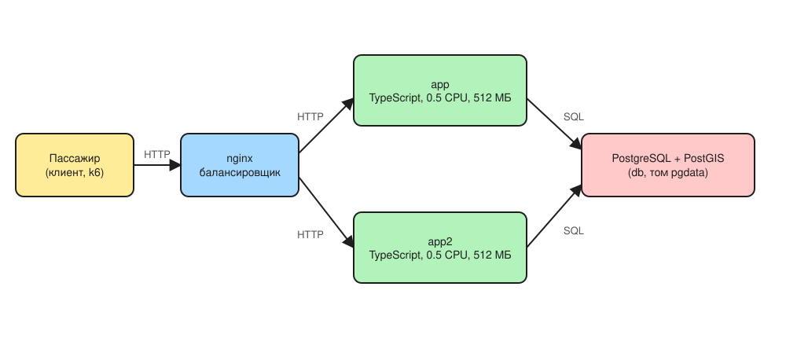
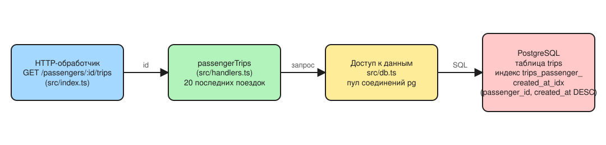

## Граница системы

Сервис заказа поездок такси даёт пассажиру три возможности: создать поездку, узнать её состояние и открыть историю своих поездок. Водитель принимает поездку и меняет её статус. В этом проекте мы отвечаем за один фрагмент системы: нагрузку на историю поездок пассажира и доступ к ней в базе данных.

**Пользователи.** Пассажир создаёт поездки и читает их состояние и историю. Водитель принимает поездки и обновляет статус.

**Что входит в границу и под нашим контролем:**

- балансировщик `nginx`, который распределяет запросы между двумя экземплярами;
- два экземпляра приложения `app` и `app2` на TypeScript;
- база данных PostgreSQL с PostGIS: таблицы `passengers`, `trips` и связанные с ними;
- миграции, профиль нагрузки k6 и отчёты о замерах.

**Что в границу не входит:** мобильные приложения пассажира и водителя (клиенты, которые шлют HTTP-запросы), внешние провайдеры карт, платежей и уведомлений. На стенде они не поднимаются, и их поведение мы не измеряем.

## Требования

Нагрузку считаем по трём потокам. Среднюю частоту получаем делением суточного числа запросов на 86 400 секунд в сутках, пиковую умножением на коэффициент пика.

| Поток | Исходные данные | Действие | Средняя | Коэффициент пика | Пик |
| --- | --- | --- | --- | --- | --- |
| Создание поездки | 200 000 поездок в сутки | 200 000 / 86 400 | 2,31 поездки/с | ×4 | 9,26 поездки/с |
| Чтение состояния | 1 запрос каждые 5 с, поездка 15 мин | 15 · 60 / 5 = 180 запросов за поездку; 200 000 · 180 = 36 000 000 запросов в сутки; 36 000 000 / 86 400 | 416,67 запроса/с | ×4 | 1 666,67 запроса/с |
| Просмотр истории | 60 000 открытий в сутки | 60 000 / 86 400 | 0,69 открытия/с | ×2 | 1,39 открытия/с |

**Объём поездок за год** при среднем потоке: 200 000 поездок/сутки · 365 суток = 73 000 000 поездок в год.

**Цель для истории:** p95 времени ответа меньше 50 мс на двух миллионах поездок. Допустимая доля ошибок составляет 0,1 процента. С этой целью сравниваются оба замера, до индекса и после него.

**Частоты локального стенда** записаны в `load/profile.json`: 5 созданий поездки в секунду, 20 чтений состояния в секунду и 5 чтений истории в секунду, прогрев 10 с, измерение 30 с.

Локальный стенд нужен, чтобы проверить причинную связь на ограниченной машине (Codespace, 2 ядра, 8 ГБ памяти): добавленный индекс сокращает работу базы и время ответа истории. Он не воспроизводит городскую нагрузку. Пик чтений состояния в городе составляет 1 666,67 запроса/с, то есть в 83 раза больше 20 запросов/с на стенде, а в базе стенда лежат 2 млн поездок, то есть около 2,7 процента годового объёма в 73 млн. Поэтому абсолютные числа замера переносятся на город только как ориентир.

## Операции

Три операции сервиса и их пиковая частота (расчёт в разделе «Требования»):

| Операция | Сценарий | Запрос | Пиковая частота |
| --- | --- | --- | --- |
| Создание поездки | пассажир заказывает поездку; запись в trips | POST /trips | 9.26 в секунду (200 000 в сутки, 2.31 в секунду в среднем, пик ×4) |
| Чтение состояния поездки | приложение пассажира и водителя опрашивает статус | GET /trips/:id | 1 666.67 в секунду (180 чтений на поездку, 36 000 000 в сутки, пик ×4) |
| История поездок | пассажир открывает список из 20 последних поездок | GET /passengers/:id/trips | 1.39 в секунду (60 000 просмотров в сутки, 0.69 в секунду в среднем, пик ×2) |

Критичная операция для этого проекта: история поездок. Она единственная читает много строк таблицы trips по полю, которого нет в первичном ключе, и поэтому первой упёрлась в предел на данных стенда.

## Окружение

Запрос пассажира проходит через балансировщик nginx на один из двух экземпляров приложения (app и app2, у каждого 0.5 CPU и 512 МБ), оба работают с одной базой PostgreSQL с PostGIS. Отдельной реплики нет: адрес реплики по умолчанию совпадает с адресом основной базы.



Исходник схемы лежит в самом файле design/architecture/environment.excalidraw.svg (сохранён со встроенной сценой, открывается в Excalidraw).

## Компоненты

Путь запроса истории: маршрут GET /passengers/:id/trips в src/index.ts передаёт идентификатор пассажира в passengerTrips (src/handlers.ts), тот через src/db.ts выполняет один SQL-запрос к PostgreSQL. Критичный путь: nginx, приложение, один запрос к trips; всё время запроса уходит на чтение таблицы, поэтому именно оно определяет p95 (см. ADR 010).



Исходник: design/architecture/components.excalidraw.svg. Решение для критичного узла: [design/adr/010-history-index.md](design/adr/010-history-index.md).

## Модель данных

Один пассажир (таблица passengers: id, name, phone) связан со многими поездками (таблица trips: id, passenger_id, driver_id, status, price, pickup_address, destination_address, cancel_reason, created_at, address_search). На стенде около 200 поездок на пассажира: 10 000 пассажиров, 2 000 000 поездок. С trips связаны trip_events и idempotency_keys.

Запрос истории:

```sql
SELECT id, passenger_id, driver_id, status, price, pickup_address, destination_address, created_at
FROM trips
WHERE passenger_id = $1
ORDER BY created_at DESC
LIMIT 20
```

Фильтр идёт по passenger_id, сортировка по created_at по убыванию, берутся 20 строк. Этим полям соответствует индекс (passenger_id, created_at DESC) из миграции db/migrations/007-trips-passenger-history-index.sql.

## Итог

Требование, измерение и решение для истории поездок:

| Требование | Baseline | Решение | После |
| --- | --- | --- | --- |
| p95 истории меньше 50 ms на 2 000 000 поездок | 157.29 ms, цель не выполнена в 3.1 раза; Parallel Seq Scan, 98.693 ms на запрос ([reports/baseline.md](reports/baseline.md)) | составной индекс (passenger_id, created_at DESC), миграция 007 ([design/adr/010-history-index.md](design/adr/010-history-index.md)) | 3.04 ms, цель выполнена с запасом больше чем в 16 раз; Index Scan, 0.182 ms на запрос ([reports/after-index.md](reports/after-index.md)) |
| Ошибок не больше 0.1% | 0.00% (0 из 953) | то же | 0.00% (0 из 953) |
| dropped_iterations равно 0 | 0 | то же | 0 |

### При каких условиях вывод верен

- Данные: 2 000 000 поездок, 10 000 пассажиров, около 200 поездок на пассажира, поездки распределены равномерно; история очень активного пассажира с тысячами поездок не проверялась.
- Нагрузка: профиль load/profile.json, 5 созданий, 20 чтений состояния и 5 просмотров истории в секунду, 30 секунд замера после 10 секунд прогрева.
- Окружение: 4 ядра и 16 ГБ памяти, два экземпляра приложения по 0.5 CPU и 512 МБ, одна база PostgreSQL без реплики; индекс (60 МБ) помещается в память базы.
- Масштаб: стенд держит около 2,7% годового объёма поездок (73 млн); с ростом таблицы на порядок вывод нужно перепроверить, потому что индекс вырастет, а холодные чтения станут дороже.
- Запись: влияние второго индекса на создание поездки отдельно не измеряли; на стенде создание идёт 5 раз в секунду против 9.26 в пике города.

### Следующий ожидаемый предел

После индекса история занимает 3.04 ms, а p95 всех запросов вместе 4.97 ms, то есть история больше не самая медленная часть. Следующим пределом ожидается чтение состояния поездки: в пике города 1 666.67 чтений в секунду против 20 на стенде, а у двух экземпляров приложения по 0.5 CPU. Это гипотеза по метрикам, она не проверена.

### Следующий опыт

- Вопрос: сохранится ли p95 истории меньше 50 ms, когда чтение состояния поездки растёт до приближенного к городскому уровню?
- Изменяемый фактор: только readRate в load/profile.json, с 20 до 200 в секунду; данные, остальные скорости (5 и 5), длительность и окружение те же.
- Критерий прохождения: p95 истории меньше 50 ms, доля ошибок не больше 0.1%, dropped_iterations равно 0. Если не пройден, смотрим загрузку CPU у app и app2 и план запроса состояния поездки.
